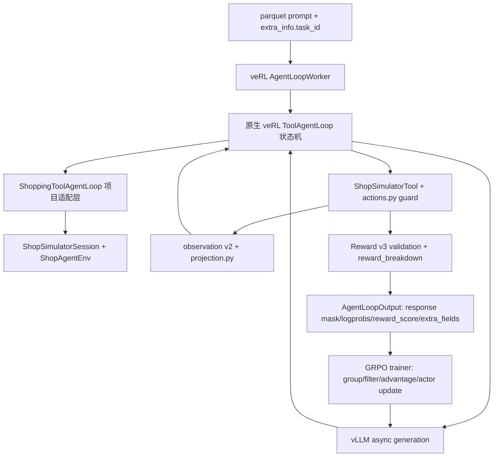

# shopping-rl 的 Agent Harness 与训练实现

这是一份从源码出发的工程说明。它回答两个容易混淆的问题：

1. 这个项目的 agent harness 究竟由什么组成？
2. 一条轨迹怎样从 parquet 中的 task 变成工具调用、环境奖励、GRPO 梯度更新？

这里的 “harness” 不是一个单独安装的产品名。项目没有另外引入 LangChain、AutoGen
或一个名为 Harness 的运行时；它采用 veRL 0.8 的 `ToolAgentLoop` 作为通用多轮循环，
再用 `shopping_grpo.training.grpo.adapter` 包裹 ShopSimulator 的环境租约、工具动作、
观测投影、动作守卫、Reward v3 校验、上下文预算和诊断字段。训练器仍然是 veRL 的
Ray/vLLM PPO/GRPO 路径，但仓库通过一个有版本校验的动态采样补丁改变了“哪些 rollout
可以进入一次 optimizer update”。

本文只读代码和配置，不启动训练、模型合并或 Final-200 评测。仓库的运行契约仍然是
`ShopSimulator environment v2.1`、`Reward v3`、`observation v2`、`tool schema v2`，
正式工作流是 `Baseline → SFT → GRPO → Evaluation`。

## 1. 先看全局：四个层次和两条循环

从调用关系看，可以把项目拆成四层：



有两条不同的循环：

- **单条 trajectory 的 agent loop**：模型生成 assistant tool call，工具推进环境，
  工具 observation 被追加到上下文，再回到模型生成；直到环境终局、上限、上下文
  错误或基础设施错误。
- **训练器的 rollout/update loop**：取一个 prompt batch，重复每个 prompt `n=4` 次，
  并行运行多条 agent trajectory；收集奖励后按 `uid` 过滤组，计算 GRPO advantage，
  执行一次 actor update，再把权重同步回 vLLM。

“harness”主要解决第一条循环的可执行性和可审计性；“训练”主要解决第二条循环的
采样、筛选和梯度更新。不要把环境动作工具误认为 optimizer，也不要把评测脚本里的
OpenAI Chat Completions loop 误认为训练时使用的 veRL loop。

## 2. veRL 原生 `ToolAgentLoop` 到底做了什么

项目依赖的 veRL 源码位于运行环境的
`.venv/lib/python3.12/site-packages/verl/experimental/agent_loop/`。核心类是
`ToolAgentLoop`，父类和 worker 在 `agent_loop.py`。仓库没有复制这个类，而是通过
`ShoppingToolAgentLoop(ToolAgentLoop)` 覆盖四个边界方法。

### 2.1 `AgentData` 是一条 rollout 的可变状态

veRL 的 `AgentData` 大致包含以下字段（实际类还包含 metrics、request id 和扩展字段）：

```text
messages             当前 chat message 历史
prompt_ids           已渲染的模型输入 token
response_ids         模型输出和工具 observation token 的序列
response_mask        模型 token=1，工具 observation token=0
response_logprobs    rollout 模型对 response token 的 log probability
tool_calls           当前 assistant 回复解析出的工具调用
turn_scores          各回合工具分数（项目工具返回 0）
tool_rewards         各工具调用的工具奖励
routed_experts       MoE 路由额外状态（如果模型提供）
extra_fields         训练器之外的诊断字段
```

关键点是：工具 observation 也会进入 `response_ids`，但其 `response_mask` 为 0。这样
它可以作为下一回合的上下文，却不会被当成 policy 产生的 action token 计算 actor loss。
`response_logprobs` 只对模型生成部分有意义；因此项目做上下文裁剪时必须同步裁剪
`prompt_ids`、`response_mask` 和 `response_logprobs`，否则 token 与 loss 对齐会被破坏。

### 2.2 原生状态机

`ToolAgentLoop.run()` 的实际控制流可以还原成下面的伪代码：

```python
messages = list(kwargs["raw_prompt"])
data = AgentData(messages=messages, ...)
schemas = selected_tool_schemas(kwargs["extra_info"])
state = PENDING

while state != TERMINATED:
    if state == PENDING:
        # apply_chat_template(..., tools=schemas, add_generation_prompt=True)
        data.prompt_ids = render_prompt(data.messages, schemas)
        state = GENERATING

    elif state == GENERATING:
        # 把工具 parser 的 stop token 放进采样参数
        result = await server_manager.generate(
            request_id=data.request_id,
            prompt_ids=data.prompt_ids,
            sampling_params=sampling_params,
            multimodal_inputs=data.multi_modal_data,
        )
        append_model_tokens(data, result.tokens, mask=1, logprobs=result.logprobs)
        data.tool_calls = tool_parser.extract_tool_calls(data.response_text)

        if response_limit_or_turn_limit(data):
            state = TERMINATED
        elif data.tool_calls:
            state = PROCESSING_TOOLS
        else:
            state = TERMINATED

    elif state == PROCESSING_TOOLS:
        calls = data.tool_calls[:max_parallel_calls]
        responses = await asyncio.gather(
            *[_call_tool(call, tools_kwargs, data) for call in calls]
        )
        append_tool_messages(data.messages, responses)
        for response in responses:
            # add_chat_template(..., remove_system_prompt=True)
            ids = render_tool_response(response)
            append_tool_tokens(data, ids, mask=0, logprob=0.0)
        state = GENERATING
```

源码中的 `PENDING → GENERATING → PROCESSING_TOOLS → GENERATING` 是项目必须保留的
主循环。父类负责 chat template、vLLM 请求、tool parser、并发工具调用、工具响应
渲染和最终 padding；项目只在这些动作的前后插入约束。

父类 `_call_tool` 的工具生命周期是：

```text
校验工具名和 JSON 参数
    ↓
FunctionTool 直接调用，或 BaseTool.create()
    ↓
await BaseTool.execute(instance_id, parameters, agent_data=...)
    ↓
finally: await BaseTool.release(instance_id)
```

`ToolResponse.text` 会按 `multi_turn.max_tool_response_length` 和
`tool_response_truncate_side` 做 veRL 层面的字符兜底截断。项目另外做了 tokenizer
级别的 observation 投影（后文详述），因为字符截断不理解 ASIN、按钮和动作守卫。

### 2.3 训练器如何找到这个 loop

这不是在 Python 入口里手动 `ShoppingToolAgentLoop(...)`。`AgentLoopWorker` 会：

1. 从 `configs/tools.json` 加载工具 schema 和工具类；
2. 读取 `rollout.agent.agent_loop_config_path`；
3. 将 YAML 列表中的每个 `name` 注册到 veRL 的 `_agent_loop_registry`；
4. 根据 `default_agent_loop: shopping_tool_agent` 找到对应配置；
5. 用 Hydra `instantiate` `_target_`，传入 `server_manager`、tokenizer、processor、
   dataset 和 `ToolListWrap(self.tools)`；
6. 调用实例的 `await agent_loop.run(sampling_params, **kwargs)`。

项目的注册配置在 [`configs/agent_loop.yaml`](../configs/agent_loop.yaml)：

```yaml
- name: shopping_tool_agent
  _target_: shopping_grpo.training.grpo.adapter.agent_loop.ShoppingToolAgentLoop
  max_steps: 35
  required_environment_version: shopsimulator-environment-v2.1
  reward_mode: constraint_aware
  context_window_tokens: 24576
  context_generation_reserve_tokens: 512
  context_safety_margin_tokens: 512
  context_input_budget_tokens: 16384
  context_compaction_enable: false
  observation_token_budget: 1536
  observation_detail_token_budget: 4096
  observation_generic_token_budget: 768
  observation_search_top_k: 20
```

因此，项目的 agent loop 是“veRL registry + Hydra target”的插件式接入，不是通过一个
外部 Harness SDK 注册。`configs/grpo.yaml`、`configs/sao.yaml` 和
`configs/sao_fully_async.yaml` 都把 `agent_loop_config_path` 指向同一份项目配置；
不同的是 trainer/rollout/SAO 配置。

## 3. 项目的 harness：`ShoppingToolAgentLoop` 的四个插入点

源码入口是 [`agent_loop.py`](../src/shopping_grpo/training/grpo/adapter/agent_loop.py)。
类注释已经说明设计意图：不重新实现模型生成，只在 context、observation 和
reward/release 边界插入项目约束。

### 3.1 初始化：把实验契约变成运行时不变量

`ShoppingToolAgentLoop.__init__` 先调用 `super().__init__`，因此仍然拥有 veRL 的
多轮配置：`max_user_turns`、`max_assistant_turns`、`max_parallel_calls`、工具响应
长度和工具 parser。然后读取项目参数并做启动期校验：

- `max_steps=35`：环境动作和 `think` 记录合计不能超过 35；
- `required_environment_version` 必须与 reset 返回的版本一致；
- `reward_mode` 只能是 `native` 或 `constraint_aware`；
- `context_input_budget_tokens` 必须小于
  `context_window - generation_reserve - safety_margin`；
- 三种 observation token budget 至少 64；
- 可选的 length shaping 只能配合 `constraint_aware`；
- soft threshold、penalty 和 max penalty 必须合法。

这一步很重要：配置错误在第一条 rollout 之前就失败，而不是运行到第 30 步才产生
不可解释的奖励。

### 3.2 `run()`：每条 trajectory 的 session 边界

项目 override 的 `run` 做的事情比父类多三件：读取 task、建立环境租约、终局结算。

```python
task_id = task_id_from_kwargs(kwargs)  # 必须来自 parquet extra_info
session = ShopSimulatorSession(...)
state = await session.start(task_id)
try:
    output = await super().run(sampling_params, **kwargs)
    if not state["done"] and not state["error"]:
        # assistant 没有完成环境任务，也不能被当作成功终局
        state["error"] = "assistant_finished_without_environment_done"
    breakdown = apply_reward_length_shaping(
        reward_breakdown(state), state, ...
    )
    output.reward_score = (
        breakdown["total"] if reward_mode == "constraint_aware"
        else terminal_reward(state, mode="native")
    )
    output.extra_fields["shopping"] = public_diagnostics(state, breakdown)
    return output
finally:
    await session.close()
```

`task_id_from_kwargs` 不会猜 task，也不会从 prompt 文本反解析；它要求 veRL parquet
样本的 `extra_info` 是 dict 且含 `task_id`。这让训练 rollout 与环境任务保持一一对应。

`finally` 是环境安全的关键。无论模型生成异常、工具异常、Reward v3 无效，还是
父类正常结束，都必须调用 `session.close()`，否则 ShopSimulator 的槽位会泄漏。

### 3.3 `ShopSimulatorSession`：同步 HTTP 客户端与异步 veRL 的边界

源码见 [`session.py`](../src/shopping_grpo/training/grpo/adapter/session.py)。
`ShopAgentEnv` 的 HTTP client 是同步的，所以所有 reset、step、release 都通过
`asyncio.to_thread` 放到线程里执行，避免阻塞 veRL 的事件循环。

`start(task_id)` 的顺序是：

1. 创建 `ShopAgentEnv(base_url, timeout)`，并设置 `include_trace_target=True`；
2. 在线程中调用 `env.reset(task_id)`；
3. 建立 `make_runtime_state(task_id, max_steps)`；
4. 读取私有 `_trace_target`，只规范化为诊断用的 ASIN/option 目标；
5. 校验 reset 返回的 `environment_version`；
6. 将首个 `observation_state` 用 `render_structured_observation` 渲染成 observation v2；
7. 设置 `current_environment` 和 `current_runtime_state` 两个 `ContextVar`。

`ContextVar` 而不是模块全局变量，是因为同一个 AgentLoopWorker 会并发运行多条
trajectory。每条 coroutine 看到自己绑定的 environment 和 state，不会把 A 任务的
工具调用打到 B 任务上。

`close()` 在线程中调用 `env.release()`，然后无论 release 是否成功都 reset 两个
ContextVar。注意：这不是 veRL 每次工具调用的 `BaseTool.release()`；它是整条
trajectory 的环境租约释放。

## 4. 工具执行：从模型 JSON 到 ShopSimulator HTTP

项目的工具实现是 [`tools.py`](../src/shopping_grpo/training/grpo/adapter/tools.py)，
通用 schema 和动作转换在 [`environment/tools.py`](../src/shopping_grpo/environment/tools.py)。

### 4.1 工具 schema 与实例生命周期

`configs/tools.json` 给 veRL 提供标准 OpenAI function schema。当前 schema 约束了
`search_products`、`open_product`、`select_option`、详情/翻页、`buy_now`、
`finish_without_purchase` 和 `think` 等工具的名称、必填字段与 `additionalProperties`。
模型生成的参数先由 veRL JSON parser 解析，再由项目动作转换器转成环境动作，例如：

```text
search_products({query: "..."})  -> search[...]
open_product({asin: "B..."})      -> click[B...]
select_option({value: "..."})      -> click[...]
finish_without_purchase(...)       -> finish[...]
```

`ShopSimulatorTool.create()` 每次返回一个 veRL tool instance id；`execute()` 使用当前
coroutine 的 ContextVar 找到真实环境；`release()` 特意是 no-op。原因是 veRL 0.8
会在每次 tool call 后执行 `release`，如果这里真的释放环境，第二个 tool call 就会
使用一个已归还的 ShopSimulator 槽位。真正的 release 由 `ShopSimulatorSession.close`
负责。

### 4.2 `execute()` 的实际分支

可将代码归纳成下面的决策树：

```text
环境不存在或 state 不存在？             -> RuntimeError
已经 done/terminate？                    -> error ToolResponse，reward=0
steps >= max_steps？                    -> terminate(max_steps)
工具是 think？                           -> 只追加 step，不调用环境
否则：
    record_action_attempt(...)
    action_reject_reason(...) != None？  -> guard rejection；连续三次则终止
    tool_call_to_action(...)             -> 失败则 infrastructure_invalid
    await to_thread(env.step, action)
    render_structured_observation(...)   -> 写入 state 和 _pending_raw_observation
    result.done 且 over=True？            -> 校验 Reward v3，写入终局字段
    非终局且到达 max_steps？             -> terminate(max_steps)
    非终局？                             -> 等 AgentLoop 的 observation projector
```

`think` 也会计入 `state["steps"]`，但不会增加 action attempt；这使得“思考步骤”和
“实际环境动作”在诊断中可区分。训练 prompt 通常要求每个 assistant 回合只发一个
环境工具，项目还在 `_handle_processing_tools_state` 中检查解析出的 call 数量；若
一次 assistant 回复包含多个 tool call，项目把它标成 `parallel_tool_calls` 并终止，
而不是依赖父类的 `max_parallel_calls` 静默执行第一个。

### 4.3 动作守卫为什么属于 harness

[`environment/actions.py`](../src/shopping_grpo/environment/actions.py) 的
`action_reject_reason` 在 HTTP 请求前检查：

- schema 外字段；
- `finish_without_purchase` 的 reason；
- 当前页面是否允许 search；
- `open_product` 的 ASIN 是否出现在最新 observation；
- 点击按钮是否仍出现在最新 observation；
- `select_option` 是否误把导航按钮当成规格。

动作守卫拒绝并不会推进环境。它把标准错误 observation 放回模型上下文，并记录
`guard_rejection_count`、原因计数、连续拒绝次数和“发生在 observation 被截断后”的
计数。连续三次拒绝会以 `too_many_guard_rejections` 终止，避免 rollout 永久循环。

`ShopSimulatorTool.execute` 还带有 veRL 的 `@rollout_trace_op` 装饰器，因而在启用
veRL rollout trace 时，工具调用可以进入 trace 系统。当前 GRPO 配置的
`shopping_trace.enable` 是 `false`，所以默认训练不额外启用 trace-based policy；
`ShopSimulatorSession` 仍然从环境的私有 `_trace_target` 规范化出诊断字段，并在
`output.extra_fields["trace_target"]` 暴露它，便于离线审计而不把 hidden goal 放入
模型 observation。`src/shopping_grpo/training/grpo/trace.py` 和 `configs/grpo.yaml` 中的
`shopping_trace` 相关字段属于可选的 trace/SAO 实验层，不是默认 GRPO 奖励。

## 5. observation harness：环境返回什么，模型真正看到什么

环境层的首要原则是“模型看得到的动作目标必须与守卫使用的目标相同”。这由两步完成。

### 5.1 先渲染 observation v2

[`environment/observation.py`](../src/shopping_grpo/environment/observation.py) 的
`render_structured_observation` 把环境 `observation_state` 渲染成结构化文本，并拒绝
隐藏字段 `{goal, reward, reward_detail, target_asin, answer}`。每次 observation 都含
可搜索性、当前页、ASIN、按钮等公共信息和 footer。这样模型不能直接读取任务答案或
奖励，同时动作守卫仍能从同一份文本读取可点击目标。

### 5.2 再做 tokenizer 级 projection

`ShoppingToolAgentLoop._call_tool` 先调用父类 `_call_tool` 得到普通 `ToolResponse`，
然后从 state 取出 `_pending_raw_observation`，调用
[`environment/projection.py`](../src/shopping_grpo/environment/projection.py) 的
`project_observation`：

```python
visible, meta = project_observation(
    tool_name=tool_call.name,
    observation=raw_observation,
    parameters=json.loads(tool_call.arguments or "{}"),
    count_tokens=lambda text: len(tokenizer.encode(text, add_special_tokens=False)),
    token_budget=1536,
    detail_token_budget=4096,
    generic_token_budget=768,
    search_top_k=20,
)
```

预算按页面类型选择：搜索结果 1536 token，商品详情 4096，其他页面 768。短 observation
原样保留；超预算的搜索页只压缩标题/字段，但必须保留当前页的每一个 ASIN 和导航
按钮。详情页和普通页不能改变可操作按钮集合。投影后会再次验证 token 数、footer、
ASIN 集合和按钮集合；失败会产生 `observation_projection_failed`，将轨迹标成
`infrastructure_invalid`，不会把坏 observation 继续喂给模型。

这也是为什么不能只依赖 veRL 的字符截断：字符截断可能留下不可点击的半个 ASIN，
或删掉 `next >`/`buy now`，造成模型和动作守卫看到的世界不一致。

`_call_tool` 最后把 `response.text` 替换为 `visible`，并把 projection metadata 写入
每步和 trajectory 级诊断，包括 raw/visible token、是否截断、可见 ASIN/按钮数量以及
footer 是否保留。

## 6. 上下文窗口管理和 token 对齐

配置中的模型窗口为 24576，生成保留 512，安全余量 512，输入预算 16384；默认
`context_compaction_enable: false`。因此默认路径不是悄悄裁剪，而是超出硬上限时把
trajectory 判为基础设施无效。

### 6.1 默认硬失败路径

`ShoppingToolAgentLoop._handle_generating_state` 每次生成前读取 `prompt_ids` 长度：

```text
prompt_tokens > 24576 - 512 - 512
    -> termination_reason=context_hard_limit_exceeded
    -> infrastructure_invalid=True
    -> 返回 AgentState.TERMINATED
```

同时把 `sampling_params["max_tokens"]` 限制到 512，确保这一轮生成不会越过预留空间。

### 6.2 打开 compaction 时如何裁剪

[`environment/context.py`](../src/shopping_grpo/environment/context.py) 的
`compact_token_trajectory` 把 `response_mask` 看成结构标记：连续的 `1` 是 assistant
生成，之后的连续 `0` 是对应 tool observation。它只删除较旧的完整 assistant/tool
组，保留最近 `preserve_recent_groups=1` 组：

```text
固定 prompt + 旧的完整组 + 最近完整组
              ↑ 可以删除       ↑ 必须保留
```

裁剪时同步更新 `prompt_ids`、`response_mask`、`response_logprobs`，并记录删除 token
和组数。如果固定 prompt 加最近保护组本身仍超预算，抛 `ContextBudgetError`，轨迹以
`context_budget_exhausted` 无效结束。

如果 veRL 提供了 `agent_data.routed_experts`，项目在发现实际删除 token 时直接以
`context_compaction_unsupported_routed_experts` 结束，因为专家路由状态没有通用安全
的裁剪协议。这个分支避免了“token 已裁剪但 MoE routing metadata 仍指向旧序列”的
隐性训练错误。

## 7. Reward v3：奖励不是工具返回值，而是 trajectory 终局契约

ShopSimulator HTTP step 返回的中间 `reward` 不直接成为 GRPO 信号。只有环境给出
`done=true`、`over=true` 且 Reward v3 结构合法时，项目才接受终局信息。

### 7.1 终局校验

`tools.py` 在终局分支检查：

1. `over is True` 且终局 reward 是有限数；
2. `reward_detail.reward_version == shopsimulator-reward-v3`；
3. `reward_type` 属于代码固定集合：`gold_purchase`、
   `valid_alternative_purchase`、`partial_alternative_purchase`、`graceful_stop`、
   `early_abstain`、`wrong_purchase`、`repeat_loop`、`max_steps`、
   `reward_unverifiable`；
4. `termination_reason == reward_type`；
5. `reward_valid`、`sampling_invalid`、`purchase_success` 类型和关系一致；
6. hard gate 的 `status/passed/verifiable` 相互一致；
7. weighted score、coverage、brand/model/core/key option 分数在 `[0, 1]`；
8. Reward v3 的 `terminal_utility` 与环境 step 的终局 reward 完全一致。

校验逻辑在 [`runtime.py`](../src/shopping_grpo/training/grpo/adapter/runtime.py) 的
`validate_reward`。任何失败都会标记 `infrastructure_invalid`，防止错误服务器响应
制造学习信号。

### 7.2 `reward_breakdown` 和两种 reward mode

`reward_breakdown(state)` 返回一组公开指标：`native`、`terminal_utility`、`full`、
`strict`、`semantic`、`r_type`、`r_att`、`r_option`、`r_price`、重复率、invalid
标记等。

- `native`：只有正常终局才返回环境的 `final_reward`；异常、未完成或基础设施无效时
  返回 0。
- `constraint_aware`：Reward v3 的 `terminal_utility` 作为总分，同时公开购买成功、
  类别/预算 gate、属性匹配、选项分数和 evidence coverage；无效或不可验证轨迹总分
  为 0，并标记 `sampling_invalid`。

当前 [`configs/agent_loop.yaml`](../configs/agent_loop.yaml) 使用
`reward_mode: constraint_aware`。可选 length shaping 在超过 20 步后按每步 0.01
扣分，最多扣 0.15；达到 max steps 会设 `overlong` 和 `sampling_invalid`。这是对
终局 utility 的训练侧整形，不会修改环境的原始 Reward v3。

### 7.3 reward 如何进入 veRL 张量

项目给 `output.reward_score` 一个 trajectory 标量，并把所有公开诊断放进
`output.extra_fields["shopping"]`。随后 veRL 的 `AgentLoopWorker._agent_loop_postprocess`
会 padding 序列，并在 `AgentLoopOutput.as_dict` 中把标量放成 `rm_scores`：通常只有
response 的最后一个位置非零。

可以把接口理解成：

```text
shopping reward scalar:        [0, 0, ..., 0, R]
response_mask:                 [1, 1, ..., 1, 0, 0, 1, ...]
token_level_rewards (无 KL):   直接采用上述 scores
```

工具 observation 的 mask 为 0，所以它们不会在 actor loss 中成为 action token。veRL
的 GRPO outcome 实现先做 `scores = token_level_rewards.sum(dim=-1)`，再把组内相对
标量乘到有效的 `response_mask` 上；因此 `rm_scores` 位于最后一个 response slot
并不会让终局分数消失，即使最后一个 slot 恰好是工具 observation。这里没有项目自定义
一个新的 PPO loss；项目做的是把可靠的轨迹标量和无效标记放进 veRL 已有的数据结构。

## 8. 从 `scripts/train_grpo.py` 到一次 GRPO update

### 8.1 启动脚本做的准备工作

[`scripts/train_grpo.py`](../scripts/train_grpo.py) 不是训练算法本身，而是把工程契约
注入 Hydra/veRL 进程。它会：

1. 检查模型目录有 `config.json` 和权重索引/权重文件；
2. 检查 train/validation parquet、Hydra config 和输出目录；
3. 设置 `PYTHONPATH`、`SHOPPING_GRPO_ROOT`、环境版本 manifest、
   `GRPO_MODEL_PATH`、数据路径、输出路径、ShopSimulator URL；
4. 设置较短的 `VLLM_RPC_BASE_PATH` 与 `TMPDIR`，避免 Unix socket 路径过长；
5. 设置 agent/tool config、诊断 JSONL 路径、config name 和 fully-async 标志；
6. 运行 `scripts/check_grpo_runtime.py` preflight；
7. 普通 GRPO 执行 `python -m verl.trainer.main_ppo`，
   `--fully-async` 或 `sao_fully_async` 则执行项目的 fully async 入口。

脚本本身不会把 task 送进环境；真正的 task 绑定发生在 `ShoppingToolAgentLoop.run`。

### 8.2 当前 GRPO 配置的关键数值

[`configs/grpo.yaml`](../configs/grpo.yaml) 的工程含义如下：

| 配置 | 当前值 | 作用 |
| --- | ---: | --- |
| `data.train_batch_size` | 2 | 一次 optimizer update 目标 prompt 数（动态采样会补 rollout） |
| `actor_rollout_ref.rollout.n` | 4 | 每个 prompt 的 GRPO group 需要 4 条 rollout |
| `rollout.mode` | `async` | vLLM 异步生成，工具执行也在 agent coroutine 中异步等待 |
| `agent.num_workers` | 8 | AgentLoop worker 数 |
| `multi_turn.max_parallel_calls` | 1 | veRL 默认每轮最多一个工具；项目还做硬失败检查 |
| `multi_turn.max_tool_response_length` | 16384 | 父类字符级工具响应兜底 |
| `rollout.max_model_len` | 24576 | vLLM 服务端序列窗口 |
| `rollout.calculate_log_probs` | true | 保存 rollout log probability |
| `algorithm.adv_estimator` | `grpo` | 组内相对优势 |
| `algorithm.norm_adv_by_std_in_grpo` | false | 关闭 GRPO 组内标准差归一化 |
| `rollout_correction.bypass_mode` | true | 使用 rollout logprob 作为 old logprob |
| `shopping_dynamic_sampling.enable` | true | 丢弃无奖励差异/无效的 group |
| `max_num_gen_batches` | 3 | 一次 update 最多生成三批以补足有效 group |
| actor lr | `1e-6` | actor optimizer 学习率 |
| `ppo_mini_batch_size` | 2 | actor mini batch |
| `ppo_micro_batch_size_per_gpu` | 1 | 单 GPU micro batch |

### 8.3 一次 rollout batch 的具体数据流

以下是当前 patch 后 trainer 的概念顺序；实现位于安装的 veRL
`verl/trainer/ppo/ray_trainer.py`，仓库用
[`patches/verl-0.8.0-shopping-dynamic-sampling.patch`](../patches/verl-0.8.0-shopping-dynamic-sampling.patch)
并由 [`scripts/apply_verl_dynamic_sampling_patch.py`](../scripts/apply_verl_dynamic_sampling_patch.py)
检查 veRL 版本和源文件 hash 后应用。

```text
train parquet batch（prompt、extra_info.task_id）
    ↓ 给每个 prompt 分配 uid
repeat_interleave(n=4)，保持同一个 uid 的四条轨迹成组
    ↓
async vLLM rollout manager
    ↓
每条 trajectory:
    ToolAgentLoop → ShoppingToolAgentLoop → ShopSimulatorSession
    → model/tool/environment 循环 → AgentLoopOutput
    ↓
reward_score + response_logprobs + response_mask + shopping diagnostics
    ↓
按 uid 抽取 seq_reward、terminal_utility、purchase_success、invalid reasons
    ↓
动态采样：保留 terminal utility 有变化且没有 sampling_invalid 的完整 group
    ↓
合并够 train_batch_size 个 prompt 的 group；不够则生成下一批（最多 3 批）
    ↓
token_level_scores / compute_advantage（GRPO）
    ↓
actor PPO clip update
    ↓
保存 checkpoint、写诊断、同步新权重到 vLLM
```

动态采样不是从 group 中挑一条“最高分”轨迹，而是保留完整 group。这样 GRPO 仍能
使用同一 prompt 的相对关系。它也不会把 `infrastructure_invalid`、
`reward_unverifiable`、overlong 轨迹变成负向样本；这些 group 被排除并记录原因。

### 8.4 动态采样的代码逻辑

[`training/grpo/dynamic_sampling.py`](../src/shopping_grpo/training/grpo/dynamic_sampling.py)
提供纯函数，训练器 patch 负责把它接入 Ray loop：

1. `build_rollout_diagnostics` 按 uid 为每条 rollout 增加 `rollout_index`；
2. `extract_shopping_group_signals` 从 `extra_fields.shopping.reward` 取
   `terminal_utility`、`purchase_success`、`sampling_invalid` 和原因；
3. `select_reward_varying_groups` 按 uid 聚合；
4. 如果组内 utility 的 `max-min <= 1e-8`，丢弃为 `constant_reward`；
5. 如果组内任意轨迹 invalid，丢弃为 `sampling_invalid`；
6. 返回原始 trajectory index，保证 prompt、response、mask、logprob 和非 tensor 字段
   用同一个索引切片；
7. 记录 all-equal、all-zero、all-purchase、no-purchase、invalid reason 等统计。

例如一组四条轨迹的 terminal utility 是 `[0, 0, 0, 0]`，即使其中一条动作序列很长，
也没有相对学习信号，整组跳过；若是 `[0, 0.4, 0, 0.8]` 且都有效，整组保留，GRPO
才有区分策略的必要信息。

当三批生成后仍凑不够一个 update，trainer 会跳过 optimizer update 并累计
`consecutive_skipped_updates`；达到 `max_consecutive_skipped_updates=10` 才停止，
防止数据全是常数奖励时无休止重采样。

patch 在 `fit()` 开始时还会拒绝不兼容组合：dynamic metric 必须是 `seq_reward`，
advantage estimator 必须是 Vanilla GRPO，`rollout_correction.bypass_mode` 必须开启，
并且 `rollout.calculate_log_probs` 必须为 true。动态模式下 `global_step` 是“已提交的
optimizer update 数”，采样补批期间只使用 `current_step = global_step + 1`，只有 actor
真的更新后才提交计数；跳过 update 不会伪造 checkpoint step。每个 generation batch、
skipped update 和 optimizer step 都可以通过 `SHOPPING_GRPO_DIAGNOSTICS_PATH` 写成
JSONL，内容包括 uid、四条 rollout 的奖励、过滤原因、采样批次和最终训练 group。
动态模式也会延迟 `checkpoint_manager.sleep_replicas()` 到有效 batch 准备好以后，
否则补采样时 vLLM replica 已经被挂起。

### 8.5 old logprob、advantage 和 actor loss

当前配置关闭 KL reward，`rollout_correction.bypass_mode=true`。因此 patch 后 trainer
使用 rollout 阶段保存的 logprob 作为 old logprob，而不是再用 actor/reference 模型
重新计算一遍 old policy。随后：

- 将 `reward_score`/`rm_scores` 作为 token-level score；
- 调用 veRL 的 `compute_advantage`，按 uid 和重复数做 GRPO 相对优势；
- 用 response mask 排除工具 observation token；
- actor 使用 PPO clip ratio `[0.20, 0.20]` 更新 LoRA 参数；
- entropy coefficient 为 0、KL loss 关闭；
- rollout manager 在 update 后加载新权重，进行下一批生成。

项目的动态 patch 不改变 Transformer 的前向或 PPO clip 公式；它改变的是训练 batch
在 advantage 之前的 group 级准入规则，以及在一次 update 内可补采样的次数。

## 9. 为什么还要区分 SFT 和在线 GRPO

GRPO 的初始模型不是 base model 直接硬跑，而是当前 SFT curriculum 的 Stage C merged
模型。SFT 与 GRPO 使用不同的 harness：

### 9.1 SFT 的数据和 loss mask

[`src/shopping_grpo/training/sft/dataset.py`](../src/shopping_grpo/training/sft/dataset.py)
使用 Transformers tokenizer/chat template 和 PEFT LoRA：

- 把 OpenAI tool call 的 JSON 字符串规范化成 Qwen3.5 chat template 需要的 dict；
- 对完整 message 和每个 assistant 边界分别渲染，检查 token 对齐；
- `labels` 默认全为 `-100`；只有 assistant 输出 span 有监督 label；
- system/user/tool observation 被 mask，不让模型复述环境反馈来“作弊”；
- 超过 `max_length` 或 template 边界不一致的样本丢弃并计数，不静默截断；
- task ID split 和选择使用稳定 hash，且有 Final-200 blind guard。

[`scripts/train_lora_sft.py`](../scripts/train_lora_sft.py) 的默认工程参数是 max length
24576、LoRA rank 16、alpha 32、dropout 0.05、gradient accumulation 8、学习率
`1e-4`；Qwen3.5 的 Gated DeltaNet projection 也在 target modules 中。curriculum
脚本训练 A/B/C 三阶段，每阶段训练后合并 adapter，Stage C merged 作为 GRPO 输入。

SFT 学的是“在离线 action-only 轨迹中哪些 assistant token 应该生成”；GRPO 学的是
“在真实环境 rollout 的 terminal utility 下，哪些完整策略相对更好”。SFT 不执行
ShopSimulator，GRPO 才进入本文前半部分的在线 harness。

### 9.2 SAO 是另一种训练配置，不是默认 GRPO loop

`configs/sao.yaml` 使用 `gae`、critic、单 rollout 等 SAO 配置；
`configs/sao_fully_async.yaml` 使用项目的 fully async Rollouter/Trainer 入口。它们仍
可以复用 `ShoppingToolAgentLoop` 和工具环境，但 actor/critic、资源分配和 correction
逻辑不同。阅读默认实验时先看 `configs/grpo.yaml`，不要把 SAO 的 GAE 解释成 GRPO 的
组内 advantage。

## 10. 评估 loop 与训练 loop 是两套 harness

[`src/shopping_grpo/evaluation/rollout.py`](../src/shopping_grpo/evaluation/rollout.py)
是 OpenAI-compatible Chat Completions/Responses evaluator：它自己维护 messages，向
模型暴露 tools，每轮收一个 tool call，调用 `ShopAgentEnv`，再把 tool message 放回
下一轮。它有自己的 context compaction、DeepSeek thinking 开关和 temperature=0 评估
参数，不调用 veRL `AgentLoopWorker`。

因此：

- **训练**：vLLM server manager + veRL `ToolAgentLoop` + 项目 `ShoppingToolAgentLoop`；
- **基础评估**：`evaluate_shop_benchmark.py` + evaluation `OpenAIChatClient` loop；
- **离线报告**：trajectory normalize、确定性 metrics、rubric/judge 和 HTML report。

两者必须共享环境版本、tool schema、observation 约束和 Reward v3 解释，否则同一模型
在训练和评测中实际看到的动作空间不同。评估脚本仍然需要自己的动作 guard 和环境
release，但不能从评估代码反推 veRL 的训练状态机。

## 11. 一个完整 task 的时序示例

假设 parquet 样本的 `extra_info.task_id=1842`，其一条 rollout 的最小事件序列是：

```text
1. AgentLoopWorker 从 parquet 取 raw_prompt 和 extra_info。
2. ShoppingToolAgentLoop.run 读取 1842，创建 ShopSimulatorSession。
3. session.start 在 ShopSimulator reset(1842)，绑定 ContextVar，生成初始 observation v2。
4. ToolAgentLoop 用 chat template 加 tools schema，调用 vLLM。
5. 模型输出 search_products(query=...)；parser 解析为 tool_call。
6. ShopSimulatorTool.create/execute；动作守卫通过；env.step 在线程执行。
7. 环境返回搜索页；render_structured_observation 后放入 _pending_raw_observation。
8. ShoppingToolAgentLoop._call_tool 做 1536-token projection，保留 ASIN 和按钮。
9. 父类把 projected observation 渲染为 tool token，response_mask=0。
10. 下一次 vLLM 生成 open_product / select_option / buy_now 等调用。
11. 若某次调用不在最新页，guard 返回 error observation，不推进环境。
12. buy_now 使环境返回 done=true、over=true、Reward v3 detail。
13. validate_reward 校验 detail；state 保存 terminal utility 和公开 gate。
14. ToolAgentLoop 结束，run 计算 reward_breakdown，设置 output.reward_score。
15. extra_fields.shopping 保存 steps、actions、guard、projection、context 诊断。
16. finally 调用 session.close，释放环境槽位并恢复 ContextVar。
17. trainer 收集同一 uid 的其他三条 rollout，决定该 group 是否进入 GRPO update。
```

如果第 8 步投影失败、上下文超过预算、环境版本错误、Reward detail 不合法或 release
出错，每种情况都有独立的 `termination_reason`/`error` 字段；其中基础设施错误不会
被伪装成“模型答错了一个商品”。这正是 harness 的价值：把模型行为、环境状态和
工程故障拆开记录。

## 12. 排查问题时应从哪里读

推荐按下面顺序阅读，而不是先从 Ray trainer 的几千行代码开始：

1. [`configs/grpo.yaml`](../configs/grpo.yaml)：知道 batch、n、mask、动态采样开关；
2. [`configs/agent_loop.yaml`](../configs/agent_loop.yaml)：知道 Hydra 实例化哪个 loop；
3. [`adapter/agent_loop.py`](../src/shopping_grpo/training/grpo/adapter/agent_loop.py)：
   看四个 override 如何围绕父类循环插入约束；
4. [`adapter/session.py`](../src/shopping_grpo/training/grpo/adapter/session.py)：看环境
   租约和 ContextVar；
5. [`adapter/tools.py`](../src/shopping_grpo/training/grpo/adapter/tools.py)：看工具、守卫、
   step、终局 Reward v3；
6. [`environment/observation.py`](../src/shopping_grpo/environment/observation.py) 与
   [`environment/projection.py`](../src/shopping_grpo/environment/projection.py)：看模型
   实际看到的 observation；
7. [`adapter/runtime.py`](../src/shopping_grpo/training/grpo/adapter/runtime.py)：看
   `reward_breakdown` 和 invalid 语义；
8. [`training/grpo/dynamic_sampling.py`](../src/shopping_grpo/training/grpo/dynamic_sampling.py)：
   看 group 级准入；
9. `patches/verl-0.8.0-shopping-dynamic-sampling.patch` 与已安装 veRL 的
   `ray_trainer.py`：看采样过滤如何接入 optimizer loop；
10. [`scripts/train_grpo.py`](../scripts/train_grpo.py)：看真正传给 Hydra 的环境变量和
    入口。

## 13. 最容易误读的工程细节

- **项目采用 harness，但不是一个外部 Harness 包。** 是 veRL loop 加项目适配层的组合。
- **项目没有重新实现模型生成。** vLLM 和父类 `ToolAgentLoop` 仍负责生成、parser、
  tool message tokenization；自定义代码负责边界约束。
- **`BaseTool.release` 不释放 ShopSimulator。** 它是 veRL 的每调用生命周期；环境 lease
  由 session 的 `finally` 释放。
- **工具 observation 是 response 序列的一部分，但 mask 为 0。** 它影响上下文，不应
  成为 actor 的 action loss。
- **中间 step reward 不直接训练。** 终局 Reward v3 通过 `output.reward_score` 进入
  veRL。
- **默认上下文超限是 invalid，不是隐式丢历史。** 只有显式打开 compaction 才裁剪，
  且会同步 mask/logprob，并拒绝无法处理的 routed experts。
- **动态采样保留完整 group。** 它筛掉常数 reward 和 invalid group，而不是选最高分轨迹。
- **评估 loop 不是 veRL loop。** 评估使用 OpenAI-compatible client，但仍应遵守同一环境
  和 Reward 契约。

如果要修改 harness，先问清楚修改属于哪一个边界：环境 lease、工具动作、可见 observation、
上下文 token、终局 reward、veRL rollout 数据结构，还是 trainer 的 group 筛选。跨边界的
改动必须同时更新诊断字段和对应的 contract/preflight；否则最常见的结果不是立刻报错，
而是产生看似正常、实际上不可比较的 reward 或训练曲线。
