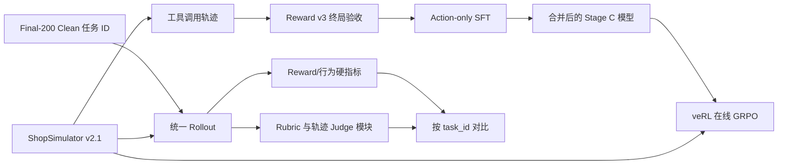

# shopping-rl 项目导读

这份文档从“一个任务如何经过环境、模型和评测”开始，解释仓库中的代码、数据、配置和
命令如何连接起来。它面向第一次接触项目的开发者，也可以作为排查训练或评测问题时的
索引。

仓库里的 Python 包名是 `shopping_grpo`，项目描述和部分脚本仍使用
`shopping-grpo`；本文把它们视为同一个项目。

## 先记住一条主线

项目的正式工作流只有四个阶段：

```text
Baseline → SFT → GRPO → Evaluation
```



模型的目标不是生成一段商品推荐文字，而是在环境里完成一串可执行动作：搜索、打开
候选、查看详情、选择规格、核验价格，最后购买或在证据不足时合理结束。训练和评测都
必须使用同一套环境版本、工具 Schema、观察投影和 Reward 版本，否则结果不可比较。

当前仓库的运行契约是：

| 项目 | 固定值 |
|---|---|
| 环境 | `shopsimulator-environment-v2.1` |
| Reward | `shopsimulator-reward-v3` |
| Observation | `shopping-observation-v2` |
| Tools | `shopping-tools-v2` |
| 最大环境步数 | 35 |
| 正式留出集 | Final-200 Clean，200 个任务 |
| 训练框架 | LoRA SFT + veRL 0.8.0 GRPO |

## 从哪里开始读

建议按下面顺序阅读：

1. 本文的“架构”和“端到端流程”，建立整体模型。
2. [`src/shopping_grpo/README.md`](../src/shopping_grpo/README.md)，了解包的职责边界。
3. [`docs/reward-v3.md`](reward-v3.md)，理解训练和评测共同使用的终局信号。
4. [`docs/sft.md`](sft.md) 与 [`docs/grpo.md`](grpo.md)，理解两个训练阶段。
5. [`docs/evaluation.md`](evaluation.md)，理解正式评测如何隔离信息并聚合结果。
6. 最后再读具体实现和测试；测试文件名通常直接对应一个协议或模块。

## 仓库地图

```text
shopping-rl/
├── environments/ShopSimulator/   内嵌环境源码、商品归档和搜索索引
├── src/shopping_grpo/             项目自己的 Python 包
│   ├── environment/               HTTP 客户端、动作守卫、工具、观察投影、上下文
│   ├── collection/                教师轨迹采集与 SFT 行构建
│   ├── training/sft/              SFT 消息渲染和 assistant-only labels
│   ├── training/grpo/             veRL AgentLoop、Reward 适配、动态采样、TRACE/SAO
│   ├── evaluation/                轨迹规范化、硬检查、Rubric、Judge、汇总和对比
│   └── resources/                 Final-200 防泄漏资源
├── scripts/                       用户入口；脚本调用 src，不另写一套实现
├── configs/                       Hydra、AgentLoop、工具和实验注册表
├── data/                          任务、SFT/GRPO 数据及哈希元数据
├── docs/                          设计说明、研究记录和报告
├── experiments/                   小型、可审计的结果摘要
├── tests/                         环境、数据、训练适配和评测契约测试
└── outputs/                       本地运行产物（模型、轨迹、报告，默认不提交）
```

几个容易混淆的边界：

- `environments/ShopSimulator/` 是冻结的环境快照；不要从外部再克隆一份环境覆盖它。
- `src/shopping_grpo/` 是项目控制层，负责把语言模型、工具和环境接起来；它不是
  ShopSimulator 本身。
- `scripts/` 是编排入口，`configs/` 是参数，真正的通用逻辑在 `src/`。
- `data/evaluation/tasks.jsonl` 只公开 `task_id`，任务 Query 和目标商品事实由环境在
  评测时恢复。

## 一次任务在环境里如何运行

### 1. 启动与租约

`bash scripts/setup.sh` 做四件事：

1. 用主 Python（默认 3.12）安装项目、SFT 和 veRL 依赖到 `.venv`；
2. 用隔离 Python（默认 3.10）安装 ShopSimulator 到
   `environments/ShopSimulator/.venv-shopsim`；
3. 校验并解压商品数据，检查固定 SHA-256；
4. 由 `build_index.py` 建立 SQLite FTS5 多字段 BM25 搜索索引，并应用带哈希校验的
   veRL 动态采样补丁。

然后在一个独立终端保持环境服务运行：

```bash
bash scripts/start_environment.sh
```

服务默认监听 `http://127.0.0.1:5700/api/shop_agent`，由
`environments/ShopSimulator/shop_env/pack_api.py` 提供。服务维护一个可复用的环境槽位
池（默认 8 个，`SHOPSIM_ENV_SLOTS` 可调整），每条 trajectory 独占一个槽位。

客户端 [`environment/client.py`](../src/shopping_grpo/environment/client.py) 只暴露三个
生命周期动作：

```text
reset(task_id)       申请槽位并加载任务
step("...")           执行一个环境动作
release()             释放槽位
```

HTTP 层只信任结构化 `result`，并把 HTTP 错误、环境错误、协议错误和生命周期错误分开。
训练和评测都在 `finally` 中释放租约，避免并发任务互相污染。

### 2. 搜索与商品状态

环境把商品的标题、品牌、品类、型号、属性、选项和卖点写入索引。查询会经过固定的
NFKC、大小写、标点和中文双字切分；BM25 按字段权重排序，并用 ASIN 做稳定的 tie-break。
默认一次返回最多 150 个结果，页面每页 20 个。

环境内部保留完整状态；模型看到的是 `structured_observation` 渲染后的文本。搜索页会
列出 ASIN、标题、品牌、价格和关键属性；商品页会列出当前选项、已选选项和价格；详情
子页提供描述、特点、评价或属性。Observation 不包含隐藏的目标商品字段。

### 3. 模型工具和动作守卫

唯一的公开工具定义在
[`environment/tools.py`](../src/shopping_grpo/environment/tools.py)，同一份 Schema
也由 [`configs/tools.json`](../configs/tools.json) 提供给 veRL：

| 工具 | 用途 |
|---|---|
| `search_products` | 搜索商品；只在当前页允许搜索时使用 |
| `open_product` | 用当前搜索结果里的 ASIN 打开候选 |
| `select_option` | 选择当前商品页面列出的颜色、尺寸、容量或套餐等选项 |
| `view_description` / `view_features` / `view_reviews` / `view_attributes` | 查看详情子页 |
| `next_page` / `prev_page` | 翻页 |
| `back_to_search` | 从详情页返回搜索结果 |
| `buy_now` | 购买并结束；不可撤销 |
| `finish_without_purchase` | 经过充分搜索仍无合适商品时主动结束 |
| `think` | 仅记录决策，不与环境交互；默认提示模型不要浪费步骤 |

动作先经过 [`environment/actions.py`](../src/shopping_grpo/environment/actions.py)：

- Schema 外字段立即拒绝；
- `open_product` 的 ASIN 必须来自最新 observation；
- 点击按钮或规格必须存在于最新 observation 的 footer；
- 详情子页只能使用当前页的返回按钮；
- 每个 assistant 回合最多一个工具调用；并行调用会使该 trajectory 终止。

被拒绝的调用会返回一个标准的 tool observation，包含拒绝原因和当前合法目标。它不会
改变环境状态，也不会伪装成一次成功的环境动作。Guard 拒绝次数、原因、截断后拒绝都
会写入轨迹诊断。

### 4. 长上下文和 Observation 投影

长程购物会产生很长的搜索和详情文本，因此模型上下文有两层保护：

1. [`environment/projection.py`](../src/shopping_grpo/environment/projection.py) 按页
   类型截断 observation：搜索页默认 1,536 token，商品详情 4,096 token，其他页 768
   token；搜索结果默认保留前 20 个展示项。
2. 投影后会再次检查所有 ASIN、按钮和 footer 是否仍可见。若压缩破坏动作契约，样本会
   标记为基础设施无效，而不是把坏输入继续喂给模型。

AgentLoop 的上下文窗口默认为 24,576 token，预留 512 token 生成空间和 512 token 安全
余量，输入预算为 16,384 token。`context_compaction` 默认关闭；打开时只压缩早期的
完整工具组，并记录删除的 token 数。无法安全压缩 routed-experts 状态时会终止并标记
无效。

## Reward v3：所有阶段共享的终局协议

Reward v3 在环境中确定性计算，训练侧不调用另一个 LLM 评判购买是否正确。它先从任务
指令和目标商品编译固定 features，再对最终选择做检查。

### 约束和分数

首先检查两个 hard gate：

- 品类必须正确；
- 选中 variant 的实际价格必须不超过预算上限。

硬约束失败是 `wrong_purchase`，Reward `-0.85`；无法从证据解析价格或品类是
`reward_unverifiable`，Reward `0.0` 且 `reward_valid=false`。

剩余偏好按激活维度加权：品牌 0.35、型号 0.25、核心功能 0.25、关键选项 0.15。匹配
分和证据覆盖率都必须为 1.0，才能称为完全满足。

| 终局类型 | Reward | 含义 |
|---|---:|---|
| `gold_purchase` | 1.00 | 购买了目标 ASIN 且所有要求满足 |
| `valid_alternative_purchase` | 0.55 | 不是目标 ASIN，但 hard gate 和全部偏好满足 |
| `partial_alternative_purchase` | `min(0.25, -0.30 + 0.55 × S)` | 只部分满足偏好 |
| `graceful_stop` | -0.15 | 至少 2 个有效结果集、打开至少 2 个候选且没有已知可接受商品 |
| `early_abstain` | -0.35 | 搜索/核验不足就放弃 |
| `max_steps` | -0.50 | 达到 35 步 |
| `repeat_loop` | -0.65 | 连续重复或持续没有新证据 |
| `wrong_purchase` | -0.85 | 品类错误或超预算 |
| `reward_unverifiable` | 0.00 | 证据不足，且 `reward_valid=false` |

环境以两次连续完全重复、四步无进展或 35 步为边界。进展包括新结果集、新商品、详情
子页、规格和约束证据；每类证据还有上限，不能靠重复动作刷进展。

Reward 的规范常量在
[`environments/ShopSimulator/shop_env/configs/environment.json`](../environments/ShopSimulator/shop_env/configs/environment.json)，
实现位于环境的 `web_agent_site/engine/reward.py` 和 `termination.py`。训练适配器会
验证环境返回的 `reward_detail`，只把合法的 Reward v3 终局交给 veRL；基础设施错误不
会被制造成学习信号。

## 数据：为什么有多套 JSONL/Parquet

数据的核心原则是 task ID 隔离。训练数据不能与 Final-200 Clean 重叠，GRPO 也不能和
活动中的 SFT 课程重叠。`prepare_grpo_dataset.py` 会同时检查 JSONL 与 Parquet 的顺序、
唯一性、拆分一致性和交集，并把审计结果写入元数据。

### 教师采集和 SFT 行

[`scripts/collect_sft_data.py`](../scripts/collect_sft_data.py) 使用 OpenAI-compatible
教师模型（当前记录为 `deepseek-v4-flash`）在真实 ShopSimulator 中执行任务。它支持
断点续跑，`raw.jsonl` 是源数据，之后根据 Reward v3 终局构建：

```text
raw.jsonl → accepted.jsonl / rejected.jsonl → sft.jsonl → train.jsonl + validation.jsonl
```

当前采集记录为 2,498 条原始轨迹、1,026 条严格接受、固定使用 1,000 条，分为 800 条
训练和 200 条验证。接受条件是完整的有效购买终局，不是第二个 LLM 的主观判断。采集
细节和审计字段见 [`docs/data-collection.md`](data-collection.md)。

每条 SFT 行保留标准 OpenAI chat 结构：用户任务、assistant tool call、工具 observation、
最终动作以及环境元数据。训练时 `training/sft/dataset.py` 用目标模型的 chat template
渲染完整对话，只把 assistant 回合（包括工具调用）对应的 token 写入 labels；system、
user 和 tool observation 都是 `-100`，不计算 loss。超长、模板边界不一致或参数 JSON
损坏的样本直接丢弃，避免截断半个工具调用。

### 当前 SFT 入口与历史入口

这里最容易误用：

| 入口 | 数据 | 用途 |
|---|---|---|
| `bash scripts/sft.sh` | `data/sft/train.jsonl` / `validation.jsonl` | 复现旧的单阶段历史 SFT |
| `bash scripts/sft_curriculum.sh` | `data/sft_pure_v4/all.jsonl` + `data/sft_curriculum/manifest.json` | 当前推荐的三阶段课程 |

Pure V4 当前共有 1,192 行，manifest 将训练行按难度分成 foundation、constraints、
strategy，并累计为：

| 阶段 | 累计训练行 | 累计验证行 | 学习率 | 作用 |
|---|---:|---:|---:|---|
| A | 256 | 28 | `1e-4` | 学会基础工具协议 |
| B | 799 | 88 | `7e-5` | 加入约束处理 |
| C | 1,073 | 119 | `5e-5` | 加入长程搜索策略 |

每阶段都是从上一个阶段的 merged checkpoint 重新挂 LoRA，默认每阶段 1 epoch、最大
序列长度 24,576、batch 1、梯度累积 8、LoRA `r=16 / alpha=32 / dropout=0.05`。
GRPO 的默认初始化是 Stage C 的 merged 模型，而不是 adapter 目录。

### GRPO 数据

当前 [`data/grpo/metadata.json`](../data/grpo/metadata.json) 记录：

- `train.parquet`：994 个任务；
- `validation.parquet`：50 个任务；
- JSONL 与 Parquet task ID 顺序一致；
- train/validation、活动 SFT 和 Final-200 交集都为 0。

Parquet 的 `extra_info.task_id` 是 veRL AgentLoop 找到任务的入口；不要只修改 JSONL 而不
同步 Parquet。刷新 canonical 数据：

```bash
.venv/bin/python scripts/prepare_grpo_dataset.py
```

### Final-200 Clean

`data/evaluation/tasks.jsonl` 只含 200 个 task ID，哈希在
`data/evaluation/metadata.json` 中固定。它用于最终一次性比较，不参与训练、Rubric/Judge
调参或 checkpoint 选择。正式评测的分母始终是这 200 个任务，缺失、报错或基础设施无效
也不能从分母删除。

## SFT：把轨迹变成初始策略

SFT 解决的是“模型不会稳定使用工具”的问题：输出合法调用、利用 observation、补齐
规格、在正确时机结束。它不直接优化 Reward，而是模仿已经在环境中验收过的 assistant
动作。

最小入口：

```bash
bash scripts/sft_curriculum.sh --dry-run
bash scripts/sft_curriculum.sh --swanlab
```

训练脚本 [`scripts/train_lora_sft.py`](../scripts/train_lora_sft.py) 负责 tokenizer/chat
template、LoRA、梯度检查点、验证 loss 和 adapter 保存；
[`scripts/merge_lora_adapter.py`](../scripts/merge_lora_adapter.py) 将 adapter 合并成
可被 vLLM/GRPO 使用的 Hugging Face 模型目录。典型产物是：

```text
outputs/models/sft-curriculum/
├── stage-a/{adapter,merged}/
├── stage-b/{adapter,merged}/
└── stage-c/{adapter,merged}/
```

验证 loss 只用于训练健康检查，不能替代 Final-200 的行为指标。应先用开发集和失败类型
覆盖选择阶段，再冻结配方进行正式留出评测。

## GRPO：在真实环境中继续优化

GRPO 从 SFT Stage C merged 模型出发，让 veRL 在 ShopSimulator 中在线生成轨迹。默认
每个 prompt 生成 4 条 rollout，以终局 Reward v3 形成组内相对优势；不使用额外的 learned
reward model。核心实现边界是：

```text
src/shopping_grpo/training/grpo/
├── adapter/            AgentLoop、session、ShopSimulatorTool、运行状态
├── dynamic_sampling.py 只保留有奖励差异的 rollout group
├── trace.py             可选的多轮 credit assignment
├── sao.py / sao_policy.py  SAO 实验损失和 critic 适配
└── compat.py            veRL/Ray/PyTorch 运行时兼容钩子
```

### 一条 GRPO rollout 的内部顺序

1. `ShoppingToolAgentLoop.run()` 从 Parquet `extra_info.task_id` 创建
   `ShopSimulatorSession`。
2. session 调 `reset`，工具调用交给 `ShopSimulatorTool`。
3. tool 先过 Action Guard，再转为环境动作字符串（例如
   `search[木梳 酒红色]` 或 `click[Buy Now]`）。
4. 环境返回原始 observation；AgentLoop 投影并记录投影统计，再把可见文本返回模型。
5. 环境到达终局后，适配器验证 `reward_detail`、终局 `over` 和 Reward v3 版本。
6. AgentLoop 写入 reward、动作、Guard、重复、上下文、投影和基础设施字段，最后释放
   环境槽位。

### 默认参数和动态采样

主配置是 [`configs/grpo.yaml`](../configs/grpo.yaml)，常用默认值如下：

| 参数 | 默认值 |
|---|---:|
| rollout 数 `n` | 4 |
| train/validation batch | 2 / 2 |
| temperature / top-p | 0.7 / 0.9 |
| policy learning rate | `1e-6` |
| 最大训练步数 | 500 |
| 保存/验证频率 | 50 / 50 |
| KL reward / KL loss | 关闭 / 关闭 |

动态采样最多生成 3 个 batch 来寻找有用更新，最多连续跳过 10 个全相同 reward 的更新。
每次 generation、optimizer step 和 skipped update 都可写入
`training_diagnostics.jsonl`，因此“没有更新”不会悄悄消失。

运行前先看解析后的命令：

```bash
bash scripts/grpo.sh \
  --model outputs/models/sft-curriculum/stage-c/merged \
  --train-data data/grpo/train.parquet \
  --val-data data/grpo/validation.parquet \
  --output outputs/models/grpo-main \
  --experiment-name shopping-agent-grpo \
  --dry-run
```

真正执行前必须先启动 ShopSimulator；GRPO 脚本会做路径、模型权重、短 socket 路径和
运行时兼容性预检查。veRL actor checkpoint 不能直接给评测服务，先导出：

```bash
bash scripts/export_grpo.sh \
  outputs/models/grpo/global_step_100/actor \
  outputs/models/grpo-merged-step100
```

### SAO 和 TRACE 放在哪里

SAO 是 GRPO 之后的实验分支，不改变主线的数据和环境契约。它使用单 rollout、GAE critic、
双侧重要性采样和可选的冻结 critic attention；配置在 `configs/sao.yaml`。完全异步版本
在 `configs/sao_fully_async.yaml`，trainer 和 rollout 使用独立 Ray 资源池，默认需要两
张 GPU。

TRACE 在 `training/grpo/trace.py`，把每个 assistant turn 的目标购买字符串作为冻结参考，
将 outcome advantage 与多轮 log-prob 变化混合到 assistant token 上。主 `grpo.yaml` 默认
关闭 TRACE；只有明确打开 `shopping_trace.enable` 才会使用它。

## Evaluation：不要把不同层面的分数混为一谈

### 基本 Rollout 入口

服务一个 Hugging Face 模型：

```bash
bash scripts/serve_model.sh outputs/models/sft-curriculum/stage-c/merged
```

然后运行：

```bash
bash scripts/evaluate.sh sft
```

它在 `data/evaluation/tasks.jsonl` 上逐题 rollout，输出：

```text
outputs/evaluation/sft/
├── trajectories.jsonl   原始完整轨迹，可断点续跑
├── summary.json         Reward/终局/步数汇总
└── report.html          可浏览的行为报告
```

多模型串行编排使用 `scripts/evaluate_sft_grpo.py`。它可以一次启动 ShopSimulator，依次
重启 vLLM，分别评估 stage-a/b/c 和一个 GRPO 导出模型；每个模型有独立 `run.json`，防止
把不同模型的断点轨迹混到一起。正式 Final-200 前先用 GRPO validation 或独立开发集选
checkpoint。

`evaluate.sh` 这条轻量入口直接生成 Reward/终局汇总和 HTML 行为报告；
`src/shopping_grpo/evaluation/` 还提供 Rubric、Judge-safe 输入、Judge Schema 和四面板
聚合所需的离线组件。阅读旧的历史报告时如果看到 Final-183，那是更早的留出集版本；当前
以 `data/evaluation/metadata.json` 的 Final-200 Clean（200 个任务）和哈希为准。

### 四个评测面板

评测包 `src/shopping_grpo/evaluation/` 把结果拆成四类：

1. **Reward/终局**：Reward 类型、strict gold success、purchase success、终止原因和
   hard gate。
2. **Query Rubric**：从代码候选和 Query 生成、再由 V4 Flash 冻结的逐任务 hard/soft
   要求；它记录 satisfied、violated、unknown 和与 Reward 的 disagreement。
3. **Trajectory Judge**：V4 Pro 只看 Actor 可见轨迹，分别给搜索策略、候选利用、证据
   核验、决策质量、终止效率 0/1/2 分，并引用真实 event ID。
4. **Deterministic/Infrastructure**：步数、工具序列、Guard、重复、Observation 截断、
   上下文和无效基础设施记录。

Rubric 由代码先生成候选，Flash 只能选择和描述已有候选，不能创造字段或值；Pro 看不到
Reward、Gold 私有字段、raw observation、成功标签或其他模型结果。这样“环境是否判为
成功”和“轨迹行为是否好”会同时保留，不能被一个总分覆盖。

实现索引：

```text
evaluation/trajectory.py   轨迹规范化和稳定 event_id
evaluation/metrics.py      确定性硬检查和行为指标
evaluation/task_facts.py   从环境恢复私有任务事实
evaluation/rubric.py       候选提取和 Rubric 物化
evaluation/prompts.py      Curator/Judge prompt 与隔离输入
evaluation/contracts.py    Schema 校验
evaluation/blind_guard.py  Final-200 防泄漏
evaluation/results.py      四面板拼装和固定分母汇总
evaluation/comparison.py   按 task_id 的模型配对比较
```

## CLI、配置和环境变量速查

已安装包提供两个不需要 GPU 或 ShopSimulator 的公开命令：

```bash
shopping-grpo smoke
shopping-grpo evaluate path/to/trajectories.jsonl
```

前者运行 CPU 合同检查；后者规范化离线轨迹并计算确定性指标。它们由
[`src/shopping_grpo/cli.py`](../src/shopping_grpo/cli.py) 实现，不能启动模型或训练。

| 需求 | 入口 | 关键环境变量 |
|---|---|---|
| 安装 | `scripts/setup.sh` | `MAIN_PYTHON`, `SHOPSIM_PYTHON` |
| 启动环境 | `scripts/start_environment.sh` | `SHOPSIM_PORT`, `SHOPSIM_ENV_SLOTS`, `SHOP_SEARCH_INDEX` |
| 运行基础模型评测 | `scripts/baseline.sh` | `LLM_BASE_URL`, `SERVED_MODEL_NAME` |
| 旧单阶段 SFT | `scripts/sft.sh` | `BASE_MODEL`, `SFT_ADAPTER_DIR`, `SFT_MERGED_DIR` |
| 当前课程 SFT | `scripts/sft_curriculum.sh` | `SFT_PYTHON` |
| GRPO/SAO | `scripts/grpo.sh` | `GRPO_MODEL_PATH`, `GRPO_TRAIN_FILE`, `GRPO_VAL_FILE`, `GRPO_OUTPUT_DIR` |
| 评测 | `scripts/evaluate.sh` | `SHOPSIM_BASE_URL`, `LLM_BASE_URL`, `LLM_API_KEY` |
| 教师采集 | `scripts/collect_sft_data.py` | `OPENAI_BASE_URL`, `OPENAI_API_KEY`, `OPENAI_MODEL` |

GRPO 的 Hydra override 放在命令末尾的 `--` 之后，例如：

```bash
bash scripts/grpo.sh -- \
  trainer.total_training_steps=20 \
  trainer.save_freq=10 \
  trainer.test_freq=10
```

## 常见排查路径

### 环境无法启动或搜索为空

先检查 `scripts/setup.sh` 是否完成、商品 archive SHA-256 是否一致，以及
`search_engine/products.sqlite3` 是否存在。环境服务日志在
`environments/ShopSimulator/shop_env/shop_env/shop_agent.log`；索引 manifest 会检查
商品数据哈希和搜索版本。

### 工具大量被拒绝

查看轨迹里的 `blocked_tool_calls` 或 GRPO 诊断中的 `guard_rejection_reasons`。最常见
原因是模型复用旧 ASIN/按钮、在详情页继续搜索、传入 Schema 外字段，或一次返回多个
tool call。先确认可见 observation 的 footer，再看 `project_observation` 是否截断。

### Reward 为 0 或样本没有学习信号

区分 `reward_unverifiable` 与基础设施无效：前者是 Reward v3 合法返回但证据不可验证，
后者通常来自环境协议、终局 `over`、Reward detail 版本、上下文预算或 observation 投影
失败。查看 `reward_valid`、`sampling_invalid`、`infrastructure_invalid` 和
`termination_reason`，不要把所有 0 都当作模型失败。

### SFT 样本数量比 JSONL 少

这是预期行为：chat template 渲染失败、工具参数不是 object、超出 `max_length` 或没有
assistant token 的行会被丢弃。训练日志里的 `total/kept/dropped` 比文件行数更能说明实际
使用了多少样本。

### GRPO 启动即失败

先用 `--dry-run`，再确认模型目录有 `config.json` 和权重，Parquet 已通过
`prepare_grpo_dataset.py`，环境 URL 可访问，输出目录为空。还要留意 vLLM/Ray 使用的
Unix socket 路径过长；`train_grpo.py` 会自动生成短的 `/tmp` 路径。

### 评测结果不能横向比较

确认所有模型使用同一个 `data/evaluation/tasks.jsonl`、同一个环境和 Reward 版本、同一
个 max steps/temperature/top-p，并且没有复用旧模型的 `run.json` 或 checkpoint。比较时
按 task ID 配对；不要只比较某个成功样本的平均 Reward。

## 验证和修改原则

纯协议或工具修改优先运行对应测试，例如：

```bash
.venv/bin/python -m pytest tests/test_action_validation.py \
  tests/test_observation_projection.py \
  tests/test_shopping_reward.py \
  tests/test_rollout.py
```

修改环境契约时，要同步检查 `environment.json`、环境实现、项目适配器、配置 Schema、
评测规范化和测试；修改数据时，要重新生成哈希并执行 task ID 交集审计。不要为了让训练
通过而放宽 Action Guard、删除无效轨迹，或把 Final-200 任务复制到训练集。

## 关键产物之间的关系

```text
data/sft_pure_v4/all.jsonl
        │ + data/sft_curriculum/manifest.json
        ▼
stage-a/merged → stage-b/merged → stage-c/merged
                                      │
                                      ▼
                             veRL actor checkpoint
                                      │ export_grpo.sh
                                      ▼
                              可服务 Hugging Face 模型
                                      │
                         evaluate_shop_benchmark.py
                                      ▼
          trajectories.jsonl + summary.json + report.html + 对比摘要
```

看模型效果时，至少同时保留三类信息：最终 Reward/终局、动作和证据质量、基础设施
健康度。只有这样才能判断一次提升究竟来自更好的购物策略，还是来自更少的协议错误、
更短的轨迹或更少的无效样本。
