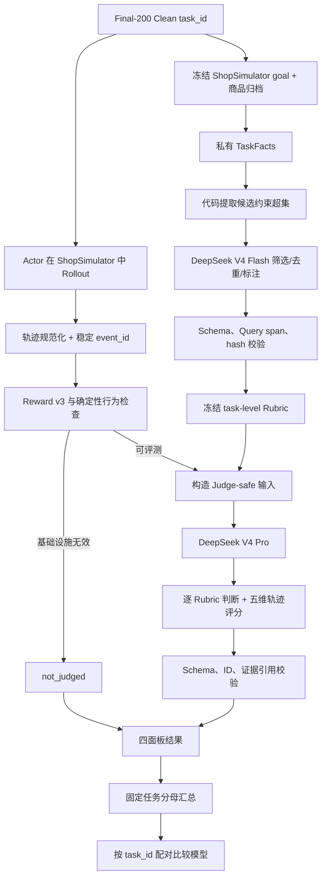

# Rubric 合成与完整评测流程

本文说明 `shopping-rl` 当前评测协议中 Rubric 的来源、约束、冻结方式，以及一条
Final-200 Clean 任务如何从环境运行到最终汇总。文中的 Rubric 是“逐任务需求评分标准”，
不是向量检索或 RAG 文档。

## 1. 先看整体流程



核心边界是：**Rubric 每道任务生成一次，Baseline、SFT、GRPO 共享同一份；每个模型
各自独立 Rollout，再使用同一 Rubric 评判。** Rubric 不由某个 Actor 的轨迹反推，避免
评测标准随模型输出变化。

## 2. 评测对象和冻结边界

当前正式评测集是 `data/evaluation/tasks.jsonl` 中的 Final-200 Clean，共 200 个任务，
文件只公开 `task_id`。Query、目标商品和 Reward goal 保存在冻结的 ShopSimulator 环境中，
不会直接写入公开 benchmark 文件。

评测使用以下固定协议：

| 项目 | 固定值 |
|---|---|
| Environment | `shopsimulator-environment-v2.1` |
| Reward | `shopsimulator-reward-v3` |
| Rubric schema | `shopping-requirement-rubric-v1` |
| Judge schema | `shopping-trajectory-judge-v1` |
| 最大环境步数 | 默认 35 |
| 每回合最大生成 | 默认 512 tokens |
| Actor 上下文窗口 | 默认 24,576 tokens |
| 正式分母 | benchmark 文件中的任务数；当前为 200 |

训练集、GRPO 数据和 Final-200 之间要求 task ID 零重叠。Final-200 在 checkpoint 和
评测配方冻结后运行，不用于 Prompt 调优、Rubric 校准或 checkpoint 选择。

## 3. Rubric 合成：从环境事实到冻结标准

### 3.1 构建私有 TaskFacts

入口是 `task_facts_from_environment()`。它按 task ID 从 ShopSimulator 的 goal 列表取出
目标 ASIN，再从商品归档取目标商品记录，调用 `build_task_facts()` 生成一个版本化快照。

TaskFacts 包含三组信息：

1. **用户侧信息**：原始 Query、指令属性、指令中的规格选项；
2. **目标商品信息**：ASIN、品类、标题、品牌、价格、属性和 customization options；
3. **Reward v3 特征**：目标品类、期望品牌/型号、核心功能、必选选项、预算上限等。

TaskFacts 会保存 `task_data_hash` 和 `query_hash`。它是 Rubric 生成的私有输入，既不发给
Actor，也不直接发给后续 Pro Judge。实现位于
[`task_facts.py`](../src/shopping_grpo/evaluation/task_facts.py) 和
[`rubric.py`](../src/shopping_grpo/evaluation/rubric.py) 的 `build_task_facts()`。

### 3.2 代码提取候选约束超集

`extract_rubric_candidates()` 不直接决定最终 Rubric，而是生成一个“可能约束”的超集。
这样做是为了让 LLM 只能在代码已经确认过的语义范围内选择。

| 候选类型 | 代码字段 | 例子 |
|---|---|---|
| `category` | `product.category in_category` | 商品品类应为木梳 |
| `brand` | `product.brand eq` | 品牌应为某品牌 |
| `model` | `product.model eq` | 型号应为某型号 |
| `core_function` | `product.attributes contains` | 商品应支持某功能/场景 |
| `option` | `purchase.options.* eq` | 颜色、容量、套餐应选某值 |
| `budget_upper` | `purchase.price lte` | 价格不超过 100 元 |
| `price_range` | `purchase.price between` | 价格在 80–100 元之间 |
| `price_preference` | `purchase.price approximately` | 价格在 20 元左右 |

每个候选包含：

- 唯一的 `candidate_id`，如 `c0001`；
- `constraint_type`、`field_path`、`operator`、`expected_value`；
- 代码初步给出的 `hardness_hint` 和 `hardness_source`；
- Query 中的原文位置 `query_spans`；
- 数据来源 `data_sources`；
- 给 Flash 使用的 `selection_guidance`。

候选的来源可以是 Query、指令结构化字段、Reward features 和目标商品结构，但目标商品
自身的全部属性不会自动成为用户需求。价格候选由代码解析“不得超过”“至少”“80 到
100 元”“20 元左右”等表达；“左右”会生成 soft 偏好，上限和明确规格通常是 hard
约束。候选随后按 `(constraint_type, field_path, operator, expected_value)` 的稳定 hash
去重。

### 3.3 V4 Flash 选择和描述候选

Rubric Curator 使用 `deepseek-v4-flash`，当前 Prompt 版本为
`rubric-curator-v1-draft-r4`。它收到的 User payload 只有：

```json
{
  "task_id": 8187,
  "query": "用户原始需求",
  "candidates": ["代码生成的候选数组"]
}
```

Flash 的任务是选择 Query 明确表达的候选、去除同义重复、写简短描述、标记
`hard` / `soft` / `needs_review`，并提供逐字存在于 Query 中的 `query_quote` 和
`selection_reason`。

Prompt 明确要求：

- 先覆盖 Query 中每个彼此独立的明确要求，再去重；
- 不能新增 `candidate_id`；
- 不能修改候选的字段、操作符或期望值；
- 不能把目标商品的所有属性自动当成用户要求；
- 品类、明确预算上限、否定要求和指定规格通常是 hard；
- “优先、最好、倾向、左右”等偏好通常是 soft；
- 不确定时使用 `needs_review`，不能强行猜测；
- 每条约束都必须有 Query 连续原文支持。

Prompt 和请求构造代码见 [`prompts.py`](../src/shopping_grpo/evaluation/prompts.py) 的
`RUBRIC_CURATOR_SYSTEM_PROMPT` 和 `build_rubric_curator_messages()`。

### 3.4 代码物化并冻结 Rubric

`materialize_rubric_bundle()` 接收 TaskFacts、候选和 Flash 输出，执行第二次收口：

1. 检查 Flash 引用的 candidate ID 存在且不重复；
2. 检查 description、selection reason 和 hardness 合法；
3. 检查 `query_quote` 是否确实是 Query 的连续子串；
4. 检查 task ID、Query、TaskFacts hash 和 Query hash 一致；
5. 从原始代码候选复制 `field_path`、`operator`、`expected_value`，不接受模型改写；
6. 生成稳定的 `rubric_id`，如 `r0001`、`r0002`；
7. 写入 extractor、curator model、Prompt version 和 hash 等 provenance。

最终 Rubric 的单条记录大致如下：

```json
{
  "rubric_id": "r0001",
  "candidate_id": "c0001",
  "constraint_type": "budget_upper",
  "description": "价格不应超过100元",
  "hardness": "hard",
  "field_path": "purchase.price",
  "operator": "lte",
  "expected_value": {"value": 100, "currency": "CNY"},
  "query_spans": [{"text": "100元以内", "start": 12, "end": 17}]
}
```

若 JSON 能解析但不符合 Schema，系统可以有限次数地进行“只修 Schema”重试；它不会放宽
约束、补造默认 Rubric。通过验证后按 `task_id` 缓存，所有 Actor 共用。

以 `task_id=8187` 为例，代码先生成 7 个候选，Flash 选择 5 条，最后冻结为品类、功能/场景、
组合规格以及价格偏好等 5 条 Rubric。这个过程是**候选受代码约束、选择由 Flash 完成、
语义字段由代码回填**。

## 4. Actor Rollout：每个模型独立完成任务

对 Baseline、SFT 和 GRPO 分别运行同一批任务。每个 Actor 使用相同的：

- ShopSimulator 环境版本和商品索引；
- system prompt、工具 Schema 和动作守卫；
- 最大步数、生成长度、温度、top-p 和上下文配置；
- Final-200 task ID 顺序。

Actor 只能看到用户 Query 和当前投影后的环境 Observation，通过工具完成：搜索、打开候选、
查看详情、选择规格、购买，或在充分探索后结束。动作会经过 Action Guard，非法工具调用
会被记录为 guard rejection，不应伪装成成功的环境动作。

常用入口是：

```bash
bash scripts/start_environment.sh
bash scripts/serve_model.sh <MODEL_PATH>
python scripts/evaluate_shop_benchmark.py \
  --benchmark data/evaluation/tasks.jsonl \
  --output outputs/evaluation/<model>/trajectories.jsonl \
  --summary outputs/evaluation/<model>/summary.json \
  --model <SERVED_MODEL> \
  --llm-base-url http://127.0.0.1:8000/v1 \
  --api-key EMPTY
```

多模型串行编排使用 `scripts/evaluate_sft_grpo.py`。每条轨迹包含 Query、assistant 工具
调用、工具 Observation、环境动作、错误、终局、上下文和诊断信息；原始轨迹写入
`outputs/`，用于后续审计和断点续跑。

## 5. 轨迹规范化和确定性检查

### 5.1 规范化事件流

`normalize_trajectory()` 将原始记录整理为
`shopping-normalized-trajectory-v1`：

- 每次动作尝试生成 `action_attempt_id`；
- 每个事件生成稳定的 `event_id`，如 `e0001`；
- 实际执行的工具步骤生成 `executed_step_id`；
- Guard 拒绝单独成为 `guard_rejection` 事件；
- 解析失败、step error、Observation 截断和上下文诊断保留；
- 默认只保留 Actor 看到的 Observation，raw observation 只能放在 audit-only 字段。

实现见 [`trajectory.py`](../src/shopping_grpo/evaluation/trajectory.py)。稳定 event ID 让
Pro Judge 可以引用证据，同时让代码验证引用确实存在。

### 5.2 确定性指标和硬检查

`compute_deterministic_metrics()` 只使用代码计算：

- Reward v3 版本、终局类型、购买成功和 strict gold success；
- 执行步数、动作尝试数和工具调用计数；
- Guard 拒绝、非法动作和 step error；
- 重复动作、重复搜索和循环迹象；
- Observation 截断、上下文 token 和 compaction；
- 环境错误、释放错误和基础设施有效性。

严格成功必须同时满足：

```text
status == done
trajectory.done == true
terminal.done == true
terminal.over == true
reward_version == shopsimulator-reward-v3
reward_type == gold_purchase
reward_valid == true
purchase_success == true
termination_reason == gold_purchase
```

基础设施错误（例如环境 HTTP 错误、超时、上下文预算失败）不会被制造成 0 分样本。
这类轨迹进入 `not_judged`，但 task 仍保留在最终分母中。

## 6. Judge-safe 输入和 V4 Pro 评判

### 6.1 Pro 能看到什么

对每个有效 Actor 轨迹，系统把以下内容发给 `deepseek-v4-pro`：

- task ID、trajectory ID 和原始 Query；
- 已冻结的 Rubric；
- Actor 当时看到的 assistant 文本、工具名、参数、环境动作和投影 Observation；
- Guard 拒绝与 step error；
- 稳定 event ID；
- 只有 `done / over` 的中性终局状态；
- 白名单确定性指标，如动作效率、重复、合法性和上下文情况；
- 冻结的错误 taxonomy 和输出 Schema。

### 6.2 Pro 明确看不到什么

Pro 不接收：

- raw observation；
- Gold 商品私有字段和 Actor 没见过的候选；
- Reward 分数、Reward type、hard gate 和 weighted score；
- strict success、purchase success 等代码成功结论；
- infrastructure validity；
- 同一任务上其他模型的结果。

这使 Pro 评的是“从 Actor 可见证据看，行为是否满足需求”，而不是根据隐藏答案倒推结果。
构造 Judge payload 的代码在 [`prompts.py`](../src/shopping_grpo/evaluation/prompts.py) 的
`build_trajectory_judge_messages()`。

### 6.3 Pro 的输出

对每条 Rubric 输出一个状态：

| 状态 | 含义 |
|---|---|
| `satisfied` | 可见证据支持需求已满足 |
| `violated` | 可见证据支持需求被违反 |
| `unknown` | 没有足够可见证据 |
| `not_applicable` | 该条约束不适用于当前决策 |

同时对轨迹的五个维度分别给 0/1/2 分：

1. `search_strategy`：搜索是否覆盖关键条件、改写是否有效；
2. `candidate_utilization`：是否利用高匹配候选、比较是否适度；
3. `evidence_verification`：是否核验属性、规格和最终价格；
4. `decision_quality`：选择商品、规格和购买/放弃是否合理；
5. `termination_efficiency`：是否过早终止、循环或无效探索。

Pro 还要输出一个主要错误、最多两个次要错误及其证据 event ID。它不能输出
`total_score` 或 `overall_score`；五个维度保持独立。

## 7. 结果拼装、冲突处理和汇总

`assemble_task_evaluation()` 把同一 task 的四类信息拼装，但不把它们合成单一总分：

### A. Reward / terminal 面板

- Reward version/type/valid；
- strict gold success、purchase success；
- final reward、terminal utility、weighted score；
- done、over 和 termination reason。

### B. Requirement Rubric 面板

- 每条 Rubric 的状态；
- hard、soft、needs_review 的分组统计；
- Reward 与 Rubric 是否不一致。

如果 Reward 判定购买成功，但 Pro 认为某条需求被违反，会记录
`reward_rubric_disagreement=true`。两种结果都保留，不互相覆盖。

### C. Trajectory quality 面板

- Pro Judge 的 `valid / invalid / not_judged`；
- 五个维度的分布和均值；
- primary / secondary error taxonomy；
- 每个判断引用的 event ID。

### D. Deterministic behavior / infrastructure 面板

- 执行步数和动作尝试数；
- 工具调用、Guard 拒绝和非法动作；
- 重复动作、重复搜索；
- Observation 截断和上下文诊断；
- 基础设施无效任务及其 task ID。

`summarize_evaluations()` 使用 benchmark 的完整任务列表作为分母，缺失、报错和
`not_judged` 任务不从分母删除。最后按 `task_id` 对 Baseline、SFT、GRPO 做配对比较，
统计成功状态变化、Reward type 变化、Rubric 违约变化、五维分数变化、步数和 Guard 变化，
不生成一个掩盖差异的综合分数。

## 8. 代码、产物和审计字段

相关实现按职责拆分：

```text
src/shopping_grpo/evaluation/
├── task_facts.py     从环境构建私有 TaskFacts
├── rubric.py         候选提取与 Flash 输出物化
├── prompts.py        Flash/Pro Prompt 和 Judge-safe payload
├── contracts.py      Rubric/Judge Schema 校验
├── trajectory.py     原始轨迹规范化和 event ID
├── metrics.py        确定性指标与硬检查
├── results.py        四面板拼装和固定分母汇总
├── comparison.py     模型间 task-level 配对比较
└── manifest.py       运行版本、Prompt 和文件哈希清单
```

一次完整离线评测应保留以下产物：

```text
shared/task_facts.jsonl
shared/rubric_candidates.jsonl
shared/rubrics.jsonl
MODEL/trajectories.jsonl
MODEL/preprocessed.jsonl
MODEL/judge_requests.jsonl
MODEL/judges.jsonl
MODEL/evaluations.jsonl
MODEL/evaluation_summary.json
model_comparison.json
```

其中 `task_facts.jsonl`、`rubric_candidates.jsonl` 和 `rubrics.jsonl` 是 Rubric 可追溯性的
关键；`generation` 字段中的 extractor version、curator model、Prompt version、task hash
和 query hash 用来确认不同模型确实共享同一套评测标准。

## 9. 当前仓库的实现边界

仓库已经提供 Rubric/Judge 所需的核心模块和契约。公开的
`scripts/evaluate_shop_benchmark.py` 主要负责 Actor rollout、轨迹保存和基础汇总；完整的
Rubric Curator、Judge 请求、结果校验和四面板汇总由 `src/shopping_grpo/evaluation/` 中的
模块组合完成，正式运行产物应按上一节的目录保存。

因此，复现实验时要区分两层：

1. **Rollout 层**：启动环境和模型，采集每个 Actor 的真实工具交互轨迹；
2. **离线评测层**：用相同的 TaskFacts、候选、冻结 Rubric 和 Judge-safe payload，完成
   Pro 评判、Schema 校验和四面板汇总。

只有两层都使用相同的环境、Reward、Prompt、Schema 和 task ID，跨模型比较才是可审计的。
