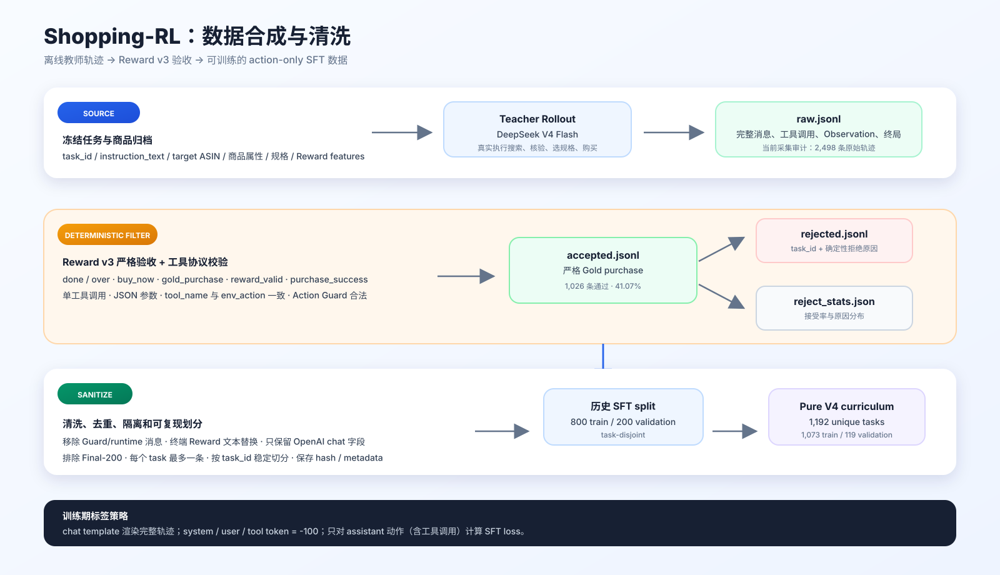
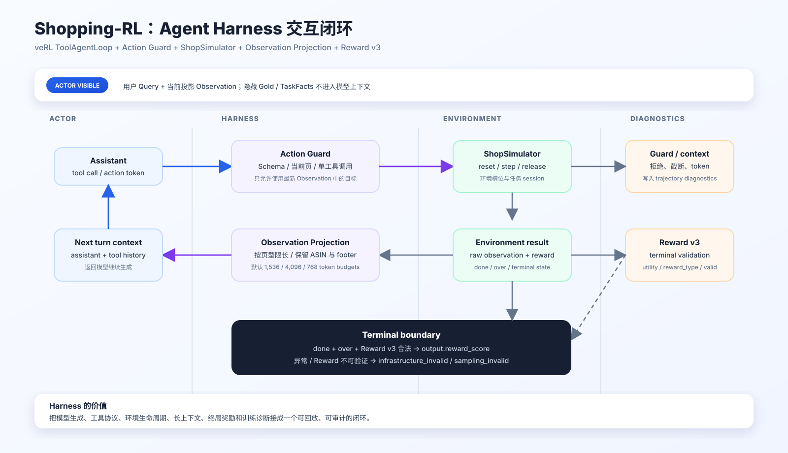
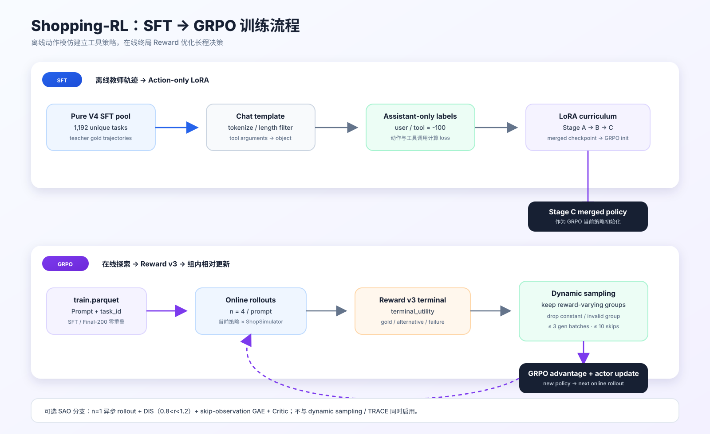

# Shopping-RL 可视化图组

这组图用来展示项目的三条主线：数据合成与清洗、Agent Harness 闭环，以及 SFT 到 GRPO 的训练过程。

图 1：教师模型在 ShopSimulator 中生成真实轨迹，Reward v3 做确定性验收，再经过工具协议清洗、去重、task 隔离和 action-only 标签处理，形成 SFT 数据。

图 2：Harness 把模型、工具、动作守卫、环境 session、Observation 投影、上下文管理和终局 Reward 接成可回放的闭环。

图 3：SFT 从离线教师轨迹学习工具策略；GRPO 使用 task Prompt 在线生成 rollout，由 Reward v3 和动态采样驱动策略更新；SAO 作为独立的单 rollout 异步训练分支。

## 使用建议

- README：优先放图 3，作为项目主流程图。
- 技术汇报：依次放图 1、图 2、图 3。
- 简历项目页：放图 2 或图 3，并配一条结果指标。
- 论文/技术文档：保留 SVG 原图，导出 PDF 或 PNG 时保持 1600px 宽度。
